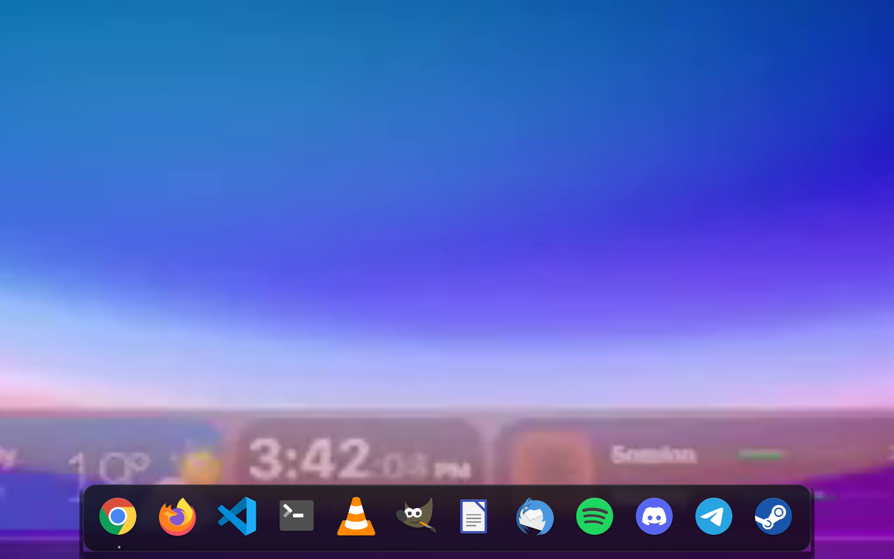
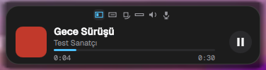
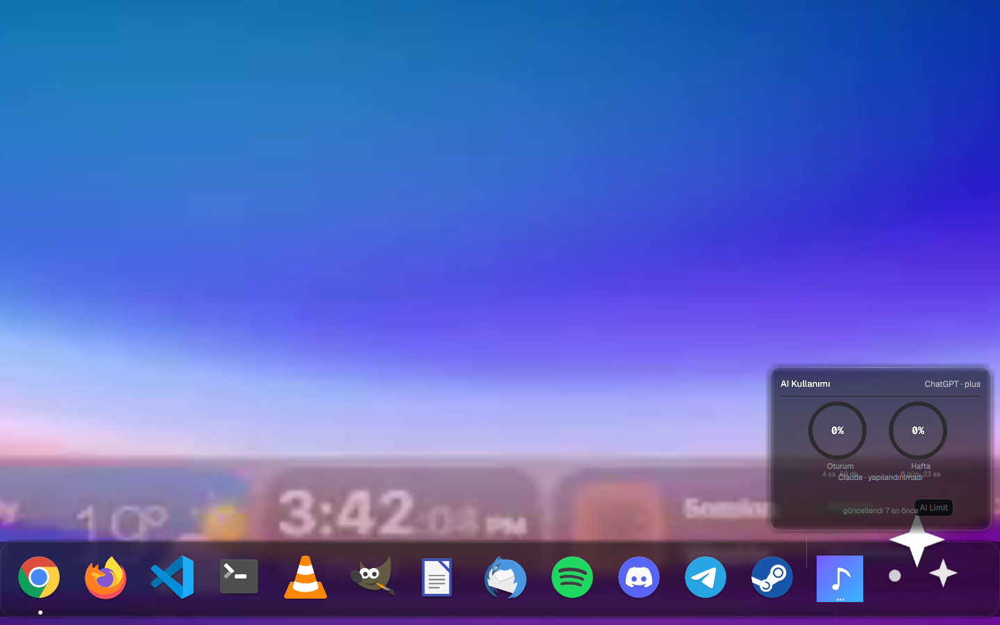
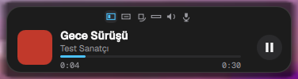
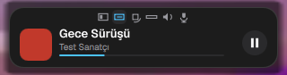
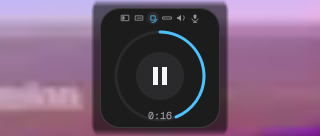
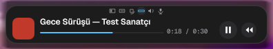
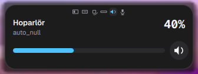
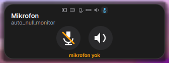

# Dock — Linux için cam görünümlü akıllı dock

macOS dock'una benzeyen, Qt6/QML ile yazılmış Linux dock'u. Simge büyütme, uygulama
başlatma, otomatik gizlenme ve iki tane cam kart: **AI kullanım limitleri** ve
**"şimdi çalıyor" müzik kartı**.

| Panel | Müzik kartı | AI limit kartı |
|---|---|---|
|  |  |  |

## Ne yapıyor

- Altında gerçek uygulama ikonları olan panel; simge üzerine gelince Mac tarzı büyütme
- Tıklayınca uygulama başlatma, otomatik gizlenme, çoklu ekran desteği
- **AI limit kartı:** ChatGPT/Codex ve Claude için oturum + haftalık kullanım çubukları;
  Codex verisi `codex app-server` JSON-RPC'den, Claude verisi Anthropic OAuth ucundan gelir.
  Veri yoksa uydurma yüzde yazmaz — "yapılandırılmadı" der.
- **Müzik kartı:** albüm kapağı, parça/sanatçı, süre çubuğu, geri/oynat/ileri;
  oynatıcı MPRIS (`org.mpris.MediaPlayer2.*`) üzerinden bulunur, yoksa demo modu
- **Tek kartta 6 görünüm:** başlıktaki seçiciden tam / kompakt / mini / bar
  "şimdi çalıyor" düzenleri ile ses çıkışı ve mikrofon; seçim yeniden açılışta hatırlanır
- Panel ve AI kartı cam görünümlü: arkasındaki masaüstü bulanıklaştırılıp bindirilir;
  müzik kartı ise tamamen opak `#1C1C1C` hap kartlardır (cam/blur yok)

## Gereksinimler

- Linux (X11; test edilen: Xvfb + xcb), Python 3.11+
- PySide6 (Qt 6) — `pip install PySide6`
- `libxcb-cursor0` (yoksa depo içindeki kopya `libs/` altında)
- İsteğe bağlı: `codex` CLI (AI limit kartı için), MPRIS destekli bir medya oynatıcı

## Çalıştırma

```bash
python3 -m venv .venv && .venv/bin/pip install PySide6
LD_LIBRARY_PATH=$PWD/libs/usr/lib/x86_64-linux-gnu:$LD_LIBRARY_PATH \
  .venv/bin/python main.py
```

`calistir.sh` aynı işi yapar; `test.sh` temel açılış kontrolünü çalıştırır.

## Dürüst sınırlar

- Bu makinede **compositor yok**, gerçek saydamlık çalışmıyor. Cam görünüm, dock
  görünmeden alınan `grabWindow` karesinin küçült/büyüt blur'u ile **simüle ediliyor**.
  Wayland + compositor olan bir masaüstünde gerçek blur'a geçmek ayrı bir iş.
- Müzik kartının demo modu gerçek bir oynatıcı taklidi yapmaz; kartta `demo · oynatıcı yok` yazar.
- AI limitleri "resmî kota" iddiası taşımaz; sağlayıcının kendi API'sinden gelen değerlerdir,
  erişim yoksa satır boş kalır.

---

## Teknik ayrıntılar

### AI limit paneli

Dock'un sonundaki kıvılcım ikonuna tıklayınca ChatGPT/Codex ve Claude için
`Session` (5 saatlik) ve `Weekly` (haftalık) kullanım çubukları açılır.

- **Codex:** `codex app-server` alt süreci JSON-RPC ile (`initialize` →
  `account/read` → `account/rateLimits/read`); plan ve `usedPercent` /
  `resetsAt` değerleri doğrudan gelir.
- **Claude:** `~/.claude/.credentials.json` içindeki `accessToken` ile
  `api.anthropic.com/api/oauth/usage` ucu okunur. Kimlik dosyası yoksa satır
  dürüstçe **"yapılandırılmadı"** yazar; uydurma yüzde üretilmez.
- **Elle yedek:** `~/.config/dock/limitler.json` içinde `claude.session` /
  `claude.weekly` sayıları varsa kimlik yokken bunlar kullanılır (kaynak: elle).
- Veriler ayrı thread'de okunur, 60 saniyede bir yenilenir; UI kilitlenmez.
- Token hiçbir yere yazdırılmaz (log/commit/ekran yok).
- Kart 320 px genişlikte, koyu `#0A0A0A` zemin ve 14 px köşe ile açılır;
  AI ikonunun üstünde ortalı konumlanır, ekran kenarına 12 px kalınca içeri kayar.
- Tipografi: 13 px başlık, 11 px etiket, 15 px bold yüzde, 10 px alt bilgi;
  çubuklar 8 px, %0'da bile 2 px başlangıç noktası gösterir. Açılış/kapanış
  120 ms `OutQuad` ile 6 px kayma animasyonu kullanır.
- Kart ve panel arka planı, dock görünür olmadan alınan ekran görüntüsünden
  16–20× küçült/büyüt blur ile üretilir; karta `%40`, panele `%80` `#0A0A0A`
  tonu bindirilir. Kart arka planı `OpacityMask` ile 14 px yuvarlak köşeye
  maskelenir; kenar `#30ffffff`, üst ışık `#3dffffff`. Metinler 1 px koyu dış
  çizgi (`GolgeText`) ile okunurluk kazanır. Kart açıkken fon 500 ms'de bir yeniden
  kompozit edilir, kapalıyken yakalama yapılmaz.

### Müzik kartı

Dock'taki nota ikonuna tıklayınca opak `#1C1C1C` "şimdi çalıyor" hap kartı açılır.
Zemin düz renktir; kapak rengi, cam, blur veya yarı saydam perde kullanılmaz.
Dört düzen: tam 360×84 (44 px kapak, başlık/sanatçı, 3 px çubuk, süreler, 32 px
oynat), kompakt 300×68 (36 px kapak, 2 px çubuk), mini 120×120 (48 px oynat +
ilerleme yayı + kalan süre), bar 380×56 (32 px kapak, tek satır, 26 px oynat +
22 px ileri).

- Gerçek oynatıcı varsa `org.mpris.MediaPlayer2.*` QtDBus arayüzünden
  Metadata/PlaybackStatus/Position okunur; düğmeler PlayPause/Next/Previous çağırır.
- Oynatıcı yoksa **demo modu** çalışır ("Midnight Drive · Demo Player", 3:48) ve kartın
  alt satırında `demo · oynatıcı yok` yazar; gerçek çalıyor izlenimi verilmez.
- Kartın üst şeridindeki 6 küçük seçici tek kartta görünüm değiştirir: tam, kompakt,
  mini, bar, ses çıkışı ve mikrofon. Seçili simge mavi `#4CC2FF`; aynı anda yalnız biri
  görünür ve seçim `QSettings("dock","muzik")` ile yeniden açılışta hatırlanır.
- **Ses çıkışı:** varsayılan sink adı, yüzde, sürüklenebilir hacim çubuğu ve mute;
  `pactl get-sink-volume` / `set-sink-volume` / `get-sink-mute` / `set-sink-mute` kullanılır.
- **Mikrofon:** kaynak adı, seviye ve mute (`pactl set-source-mute`). Gerçek mikrofon
  yoksa `.monitor` kaynağı yedek olarak gösterilir ve kart "mikrofon yok" yazar; mute
  yine çalışır, kart çökmez.
- AI limit ve müzik kartlarından yalnızca biri açık olabilir; dışına tıklamak kapatır.

#### Görünümler

| Tam | Kompakt | Mini |
|---|---|---|
|  |  |  |
| Tam · 360×84 | Kompakt · 300×68 | Mini · 120×120 |

| Bar | Ses çıkışı | Mikrofon |
|---|---|---|
|  |  |  |
| Bar · 380×56 | Ses çıkışı · 320×110 | Mikrofon · 320×110 |

#### Müzik kartı cila

- Demo parça `Midnight Drive` / `Demo Player · Single`; "Demo · Demo" tekrarı yok.
- Kontrol grubu kart merkezine tam ortalı, eşit aralıklı; geri/ileri glifi 16 px,
  tıklama alanı 28×28, oynat 28 px daire.
- Alt satır/süreler `#9A9AA0`, footer `#8E8E93` ve 11 px.
- AI kartında plan/yüzde/geri sayım sağ kenarı 16 px iç boşlukta tek çizgiye hizalıdır.
- `kanit/dock-demo.mp4`: 15 sn, 1280×720 H.264; büyütme → müzik kartı → kapat →
  AI limit kartı → kapat sırasını gösterir (Xvfb `:99`, dikey offset 180).

## v9 düzeltmeleri

- Panel gölgesi 20 px iç payla üretilir (sert plaka yok); panel camı genişlik
  değişiminde `_tam`dan yeniden üretilir, esneme olmaz.
- Giriş maskesi X11 `ShapeInput` ile yalnız panel + açık kartı kapsar; dock
  üstündeki boş şerit tıklamayı arkadaki pencereye geçirir.
- Otomatik gizlenme animasyonu sırasında ekran yakalama yapılmaz.
- Codex stdout satır tamponu; hata/timeout'ta son iyi veri + `veri gelmedi`.
- Claude'da kimlik yok → `yapılandırılmadı`, süresi dolmuş → `oturum süresi doldu`;
  kısmi elle veride eksik alan `veri yok` yazar.
- MPRIS'te çalan oynatıcı seçilir, servis kaybolunca demo moduna dönülür.
- Panel tonu %59'a çekildi; komşu büyütme 0.65/0.25 oranıyla azalır; müzik/AI
  grubu arasında 1 px ayırıcı; açık uygulama noktası 6 px.
- AI kartında `Oturum/Hafta`, en küçük yazı 11 px, `v0.1` kaldırıldı.
- Kart maskesi QML'den kaldırıldı (Python kompoziti zaten yuvarlatılmış);
  kart açıkken CPU %1.15.
- Gerçek saydamlık (picom) denendi: sistemde `picom`/`compton` yok, `sudo`
  olmadan kurulum yapılamıyor; AppImage indirilemedi. Bu nedenle kompozit cam
  tekniği korunuyor.

## Fontlar

Geist + Geist Mono (SIL OFL, `assets/fonts/`). Açılışta tüm TTF'ler
`QFontDatabase.addApplicationFont` ile yüklenir; aile bulunamaz veya yükleme
başarısız olursa uygulama hata basıp çıkar. Varsayılan `Geist 11`; yüzdeler,
süreler, geri sayımlar ve halka içi değerler `Geist Mono` kullanır.

## v13 kapak işleme ve ölçüler

- Kapak/renk yalnız `mpris:trackid` veya `artUrl` değişince işlenir; aynı parçada
  tekrar okuma **0 işlem** yapar (`DOCK_KAPAK_LOG` sayacı).
- `http(s)` kapaklar arka planda indirilir (5 sn timeout), önceki kapak korunur;
  önbellek `~/.cache/dock/kapak/<sha1>.jpg` + `.json` (baskın renk). `data:`/`file://`
  doğrudan çözülür; başarısızlıkta demo kapağı ve log.
- İkon 64 px, müzik ikonundaki kapak %80 (~51 px); AI halkaları 84 px/6 px;
  kart alt kenarı panel üst kenarından 16 px. Panel pencere payı 120 px ile
  ekran kenarına değmiyor.
- Geist Mono yalnız rakam/geri sayım değerlerinde; birimler ve etiketler Geist.
- `test_v13.sh`: gerçek mpv + MPRIS + http artUrl, track geçişi ve 50 ms timer
  gecikmesini ölçer. Son ölçüm: max 66.9 ms, p95 61.9 ms (<100 ms).
- Not: mpv-mpris 1.1 `artUrl`'i boş `data:image/jpeg;base64,` döndürdüğü için
  gerçek mpv testi fallback yolunu sınar; uzak indirme yolu test env artUrl ile doğrulandı.
